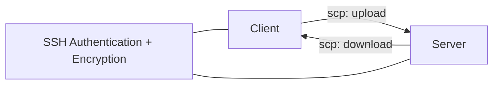

# SCP: ส่งและดึงไฟล์ระหว่าง Client กับ Server

`scp` (secure copy) ใช้คัดลอกไฟล์ผ่าน SSH โดยตรง เหมาะกับงานที่รู้ไฟล์ต้นทางและปลายทางชัดเจน และต้องการสั่งงานจบในคำสั่งเดียว

## Mental Model



`scp` ไม่ได้เปิดพื้นที่จัดเก็บใหม่บน Server และไม่ใช้ Public Key คนละแบบกับ SSH แต่ใช้การยืนยันตัวตนและสิทธิ์ของ SSH เดิม

## Syntax หลัก

```bash
scp [options] <source> <destination>
```

รูปแบบ Remote Path:

```text
<user>@<host>:<path>
```

ถ้าใช้ Host Alias ใน `~/.ssh/config` ให้ใช้ Alias แทน `<host>` ได้

## Upload: Client → Server

ส่งไฟล์ไปยัง Home Directory ของ User:

```bash
scp ./local-file.txt <user>@<host>:~
```

ส่งไปยังโฟลเดอร์ปลายทาง:

```bash
scp ./build/app.tar.gz <user>@<host>:/tmp/
```

ถ้าใช้ Alias:

```bash
scp ./build/app.tar.gz <alias>:/tmp/
```

## Download: Server → Client

ดึงไฟล์จาก Server มาไว้ในโฟลเดอร์ปัจจุบัน:

```bash
scp <user>@<host>:/var/log/app.log ./
```

ดึงมาแล้วเปลี่ยนชื่อ:

```bash
scp <alias>:/tmp/app.tar.gz ./app-from-server.tar.gz
```

## ส่งและดึงทั้งโฟลเดอร์ด้วย `-r`

`-r` (recursive) ใช้คัดลอกโฟลเดอร์และเนื้อหาภายในทั้งหมด:

```bash
# Client → Server
scp -r ./local-folder <alias>:/tmp/

# Server → Client
scp -r <alias>:/tmp/remote-folder ./
```

> [!warning] ระวังตำแหน่งปลายทาง
> ถ้า `/tmp/remote-folder` มีอยู่แล้ว ผลลัพธ์อาจกลายเป็น `/tmp/remote-folder/local-folder` ตามชื่อโฟลเดอร์ต้นทาง ตรวจด้วย `ssh <alias> "ls -la <path>"` ก่อนส่งข้อมูลสำคัญ

## Options ที่ใช้บ่อย

| Option | ใช้ทำอะไร | ตัวอย่าง |
|---|---|---|
| `-r` | คัดลอกโฟลเดอร์แบบ Recursive | `scp -r ./dist <alias>:/tmp/` |
| `-P` | ระบุ SSH Port (ตัวใหญ่) | `scp -P 2222 file <alias>:/tmp/` |
| `-i` | ระบุ Private Key | `scp -i ~/.ssh/id_ed25519 file <alias>:/tmp/` |
| `-p` | รักษาเวลาแก้ไขและ Permission ของไฟล์ | `scp -p file <alias>:/tmp/` |
| `-v` | แสดงรายละเอียดเพื่อ Debug | `scp -v file <alias>:/tmp/` |
| `-C` | บีบอัดระหว่างส่ง เหมาะกับไฟล์ที่บีบอัดได้ | `scp -C file <alias>:/tmp/` |

> [!important] `-P` กับ `-p` ไม่เหมือนกัน
> `-P` คือ Port ของ SSH ส่วน `-p` คือพยายามรักษา Metadata ของไฟล์

## ใช้ Config เดิมของ SSH

เมื่อมี Alias ใน `~/.ssh/config` แล้ว `scp` จะใช้ `HostName`, `User`, `Port` และ `IdentityFile` จาก Alias เดียวกับ `ssh`:

```bash
ssh <alias>
scp ./file.txt <alias>:/tmp/
```

## ตรวจสอบหลังส่ง

```bash
ssh <alias> "ls -lh /tmp/file.txt"
ssh <alias> "sha256sum /tmp/file.txt"
shasum -a 256 ./file.txt
```

เปรียบเทียบค่า Hash เมื่อจำเป็นต้องยืนยันว่าไฟล์ไม่เสียหายระหว่างทาง

## ข้อจำกัดของ `scp`

- เหมาะกับการส่งหรือดึงแบบครั้งเดียว ไม่เหมาะกับการ browse ไฟล์จำนวนมาก
- ต้องมีสิทธิ์อ่านไฟล์ต้นทางและสิทธิ์เขียนโฟลเดอร์ปลายทาง
- `-r` ไม่ใช่การ Sync: ไฟล์ปลายทางที่ไม่อยู่ในต้นทางจะไม่ถูกลบ
- หากต้องการเข้าไปดูไฟล์, เลือกส่งทีละรายการ หรือทำงานหลายขั้นตอน ให้ใช้ [[SSH-SFTP-File-Transfer]]

## Troubleshooting

| อาการ | จุดตรวจ |
|---|---|
| `Permission denied` | User, Key, Permission ของไฟล์ต้นทางและโฟลเดอร์ปลายทาง |
| `No such file or directory` | Path ฝั่งใดผิด ตรวจด้วย `pwd` และ `ls` |
| `Connection refused` | Port และ `sshd` บน Server |
| ส่งโฟลเดอร์แล้วซ้อนชั้นผิด | ตรวจว่าปลายทางมีโฟลเดอร์ชื่อเดียวกันอยู่แล้วหรือไม่ |

## Related Notes

- [[SSH-Daily-Playbook]] — เลือกคำสั่งตามงานประจำวัน
- [[SSH-SFTP-File-Transfer]] — จัดการไฟล์แบบ Interactive
- [[SSH-Command-Reference-and-Cheatsheet]] — Reference รวมคำสั่ง
