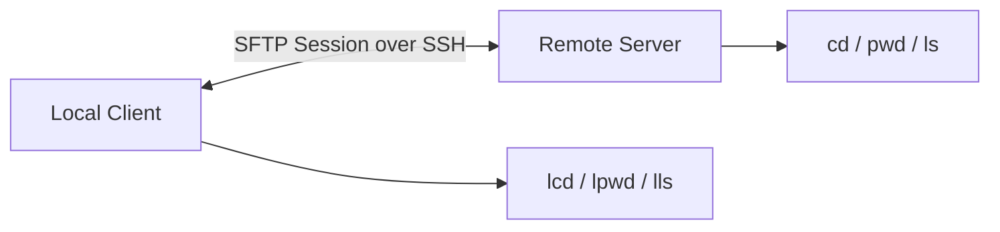

# SFTP: จัดการไฟล์ระหว่าง Client กับ Server

`sftp` (SSH File Transfer Protocol) เปิด Session สำหรับ browse และจัดการไฟล์บน Server ผ่านช่องทาง SSH เดียวกับที่ใช้ Login เหมาะกับงานที่ต้องดูหลายไฟล์, เลือกส่งทีละรายการ หรือทำงานหลายคำสั่งต่อเนื่อง

## เริ่ม Session

```bash
sftp <user>@<host>
sftp <alias>
```

ระบุ Port หรือ Key:

```bash
sftp -P 2222 <user>@<host>
sftp -i ~/.ssh/id_ed25519 <user>@<host>
```

> [!important] ใช้ `-P` ตัวใหญ่สำหรับ Port

## Mental Model



ภายใน Session จะมี Current Directory สองฝั่ง:

- **Local:** เครื่อง Client ใช้ `lpwd`, `lcd`, `lls`
- **Remote:** Server ใช้ `pwd`, `cd`, `ls`

## คำสั่งพื้นฐาน

| คำสั่ง | ทำงานกับ | ใช้ทำอะไร |
|---|---|---|
| `pwd` | Server | ดูโฟลเดอร์ปัจจุบัน |
| `lpwd` | Client | ดูโฟลเดอร์ปัจจุบันของ Client |
| `ls` | Server | ดูไฟล์บน Server |
| `lls` | Client | ดูไฟล์บน Client |
| `cd <dir>` | Server | เปลี่ยนโฟลเดอร์บน Server |
| `lcd <dir>` | Client | เปลี่ยนโฟลเดอร์บน Client |
| `get <file>` | Server → Client | ดึงไฟล์ |
| `put <file>` | Client → Server | ส่งไฟล์ |
| `exit` / `bye` | Session | ออกจาก SFTP |

## Download: Server → Client

```text
sftp> pwd
sftp> ls
sftp> lcd ./downloads
sftp> get app.log
sftp> get config.yml ./config-from-server.yml
```

## Upload: Client → Server

```text
sftp> lpwd
sftp> lls
sftp> cd /tmp
sftp> put ./build/app.tar.gz
sftp> put ./config.yml ./config-uploaded.yml
```

## ส่งและดึงโฟลเดอร์ด้วย `-r`

ใช้ `put -r` เพื่อส่งโฟลเดอร์ และ `get -r` เพื่อดึงโฟลเดอร์:

```text
sftp> put -r ./local-folder
sftp> get -r /tmp/remote-folder
```

สร้างโฟลเดอร์ปลายทางก่อนส่งได้ด้วย:

```text
sftp> mkdir /tmp/upload
sftp> cd /tmp/upload
sftp> put -r ./local-folder
```

## จัดการไฟล์บน Server

```text
sftp> mkdir /tmp/archive
sftp> rename /tmp/app.log /tmp/archive/app.log
sftp> rm /tmp/old-app.log
sftp> rmdir /tmp/empty-folder
```

คำสั่ง `rm` และ `rmdir` ลบไฟล์บน Server โดยตรง ควรตรวจด้วย `ls` ก่อนทุกครั้ง

## ทำงานแบบ Batch

เหมาะกับการส่งคำสั่งหลายรายการโดยไม่เปิด Interactive Session:

```bash
sftp -b - <alias> <<'EOF'
cd /tmp
put ./build/app.tar.gz
ls
EOF
```

ตรวจผลลัพธ์และ Exit Code ของคำสั่ง Batch ก่อนถือว่างานสำเร็จ

## SFTP กับ SCP เลือกอะไรดี?

| งาน | เลือก |
|---|---|
| ส่งไฟล์เดียวด้วยคำสั่งเดียว | `scp` |
| ส่งโฟลเดอร์แบบรวดเร็ว | `scp -r` |
| ต้อง browse และเลือกไฟล์หลายรายการ | `sftp` |
| ต้องเปลี่ยนชื่อ, สร้างโฟลเดอร์ หรือลบไฟล์ระหว่าง Session | `sftp` |
| ต้องทำงานหลายขั้นตอนแบบ Script | `sftp -b` |

ทั้งสองคำสั่งใช้ SSH Authentication, Host Key และ Permission ของ Server เดียวกัน

## Troubleshooting

| อาการ | จุดตรวจ |
|---|---|
| เข้าได้แต่ `put` ไม่ได้ | สิทธิ์เขียนของ Remote Directory |
| `get` ไม่ได้ | สิทธิ์อ่านไฟล์และ Path ฝั่ง Server |
| `No such file` | ตรวจ `pwd`, `lpwd`, `ls` และ `lls` แยกคนละฝั่ง |
| Session หลุดบ่อย | ตรวจ Network และค่า `ServerAliveInterval` ใน SSH Config |

## Related Notes

- [[SSH-Daily-Playbook]] — Workflow ใช้งานประจำวัน
- [[SSH-SCP-File-Transfer]] — คัดลอกไฟล์แบบคำสั่งเดียว
- [[SSH-Client-Configuration-and-Aliases]] — ตั้ง Alias และ Key
