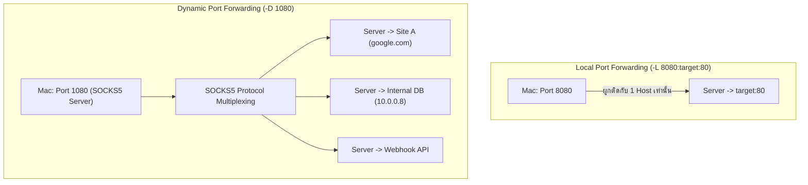

# SSH Dynamic Port Forwarding & SOCKS5 Proxy

**Dynamic Port Forwarding (`-D`)** คือการเปลี่ยน SSH Client ของเราให้กลายเป็น **SOCKS5 Proxy Server** ท้องถิ่น ซึ่งมีความยืดหยุ่นสูงกว่า Local Port Forwarding เพราะไม่ต้องเจาะจงปลายทางล่วงหน้า

---

## 1. เปรียบเทียบ `-L` (Static Forwarding) vs `-D` (Dynamic Proxy)



| คุณสมบัติ | Local Forwarding (`-L`) | Dynamic Forwarding (`-D`) |
| :--- | :--- | :--- |
| **จำนวนเป้าหมาย** | ได้แค่ 1 โฮสต์และ 1 พอร์ตตายตัวต่อ 1 พอร์ต Local | ส่งไปยังปลายทางใด ๆ ก็ได้นับไม่ถ้วนพร้อมกัน |
| **ระดับเลเยอร์** | TCP Transport Layer (Layer 4 Forwarding) | Session Layer (Layer 5 SOCKS5 Proxy Protocol) |
| **การใช้งานของ Client** | เข้าตรง ๆ ผ่าน `http://localhost:8080` | ต้องตั้งค่าในเบราว์เซอร์หรือเครื่องมือให้ชี้เข้า SOCKS Proxy |

---

## 2. การสร้างและทดสอบ SOCKS5 Proxy

```bash
# เปิด SOCKS5 Proxy บนพอร์ต 1080 ของ Mac ในโหมด Background
ssh -N -f -D 1080 chubu
```

### การทดสอบด้วย `curl` และประเด็นเรื่อง Remote DNS Resolution

> [!IMPORTANT] 📚 ความลับของ Remote DNS Lookup (--socks5-hostname)
> - **แบบที่อาจเกิดปัญหา (DNS หลุดที่ Local):**
>   ```bash
>   curl --socks5 127.0.0.1:1080 http://internal.corp
>   ```
>   เครื่อง Mac จะพยายามทำ DNS Query หา IP ของ `internal.corp` ผ่าน DNS ท้องถิ่นของ Mac เอง ซึ่งอาจไม่พบ หรือทำให้ข้อมูลองค์กรหลุด
> - **แบบที่ถูกต้องและปลอดภัย (Resolve ฝั่ง Server):**
>   ```bash
>   curl --socks5-hostname 127.0.0.1:1080 http://internal.corp
>   ```
>   เครื่อง Mac จะส่ง String ชื่อโดเมน `"internal.corp"` เข้าไปในท่อ SSH ให้เครื่อง Ubuntu Server เป็นผู้ทำ DNS Query ให้ จึงสามารถเข้าถึงชื่อโฮสต์ภายในเครือข่ายของเซิร์ฟเวอร์ได้

---

## 3. ทำไมรัน `ssh -D 1080` แล้วเครื่องไม่ได้วิ่งผ่าน Proxy อัตโนมัติ?

คำสั่ง `ssh -D` มีหน้าที่เพียงแค่ **เปิด Socket Port 1080 รอรับโปรแกรมที่รองรับ SOCKS5 เท่านั้น** ไม่ได้ไปดัดแปลง Default Gateway หรือ Routing Table ของระบบปฏิบัติการ
- หากต้องการให้ระบบทั้งหมดวิ่งผ่าน SOCKS5:
  1. ต้องกำหนดค่า Proxy ใน System Settings ของ macOS
  2. หรือกำหนดในโปรแกรมแต่ละตัว (เช่น Firefox Settings > SOCKS Host)
  3. หรือใช้เครื่องมือดักแพ็กเก็ต เช่น `proxychains-ng`

---

## 🔗 โหนดความรู้ที่เกี่ยวข้อง (Related Nodes)
- [[SSH-Local-Port-Forwarding]] — การทำ Forward แบบ Static 1 ต่อ 1
- [[Foundational-Networking-and-Sockets]] — DNS Resolution และ TCP Socket Mechanics
- [[SSH-Command-Reference-and-Cheatsheet]] — ตัวอย่างคำสั่ง SOCKS5 และ curl
- [[SSH-Common-Misconceptions-and-Troubleshooting]] — ความเข้าใจผิดเกี่ยวกับ SSH Proxy
