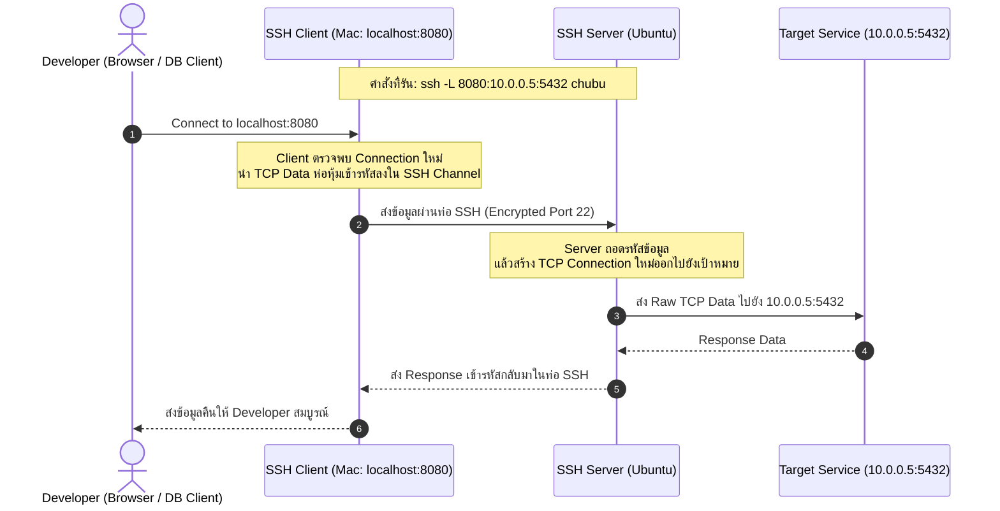

# SSH Local Port Forwarding (-L)

**Local Port Forwarding (`-L`)** คือรูปแบบการทำ Tunneling ยอดนิยมที่ใช้สำหรับ **"เปิดประตูรับสายที่เครื่อง Client ของเรา แล้วส่งต่อข้อมูลผ่านท่อ SSH ไปออกยังเครื่องปลายทางหลังบ้านของ Server"**

---

## 1. ไวยากรณ์และโครงสร้างคำสั่ง

```bash
ssh -L [local_bind_address:]local_port:destination_host:destination_port user@ssh_server
```

### ตัวอย่างคำสั่งจริง

```bash
# เปิดพอร์ต 8080 บน Mac เพื่อเข้าถึง PostgreSQL (พอร์ต 5432) ที่ซ่อนอยู่ในเครือข่ายภายในของ Ubuntu
ssh -N -f -L 8080:10.0.0.5:5432 chubu
```

- **`-L` (Local Forward):** กำหนดกฎการทำ Forwarding
- **`8080` (Local Port):** พอร์ตที่ต้องการให้เครื่อง Client (Mac) เปิดดักฟัง (Listen)
- **`10.0.0.5` (Destination Host):** เครื่องปลายทาง (มองจากมุมมองของ Ubuntu Server)
- **`5432` (Destination Port):** พอร์ตปลายทางที่เครื่องเป้าหมายเปิดบริการอยู่
- **`-N` (No Remote Command):** ไม่ต้องเปิด Interactive Shell (สร้างเฉพาะท่อ Tunnel)
- **`-f` (Background):** สลับกระบวนการทำงานไปอยู่เบื้องหลังทันทีหลังต่อติด

---

## 2. แผนภาพเส้นทางการไหลของแพ็กเก็ต (Packet Flow)



---

## 3. จุดสำคัญที่มักเข้าใจผิด
- ค่า `destination_host` (เช่น `localhost` หรือ `10.0.0.5`) จะถูก **Resolve และเชื่อมต่อโดยเครื่อง SSH Server (Ubuntu) เสมอ ไม่ใช่เครื่อง Mac**
- ดังนั้นหากระบุ `ssh -L 8080:localhost:3000 chubu` หมายถึง: ให้ Mac เปิดพอร์ต 8080 แล้วพาไปหาพอร์ต 3000 ที่เป็น **`localhost` ของเครื่อง Ubuntu**

---

## 🔗 โหนดความรู้ที่เกี่ยวข้อง (Related Nodes)
- [[SSH-Remote-Port-Forwarding]] — การทำ Forwarding ในทิศทางย้อนกลับ (-R)
- [[SSH-Dynamic-Port-Forwarding-and-SOCKS5]] — การทำ Dynamic Proxy ที่ไม่ต้องระบุปลายทางล่วงหน้า (-D)
- [[Localhost-Loopback-and-Port-Binding]] — ความเข้าใจเรื่องการ Bind Address
- [[SSH-Command-Reference-and-Cheatsheet]] — รวมคำสั่ง Port Forwarding และแฟลก `-f`, `-N`
