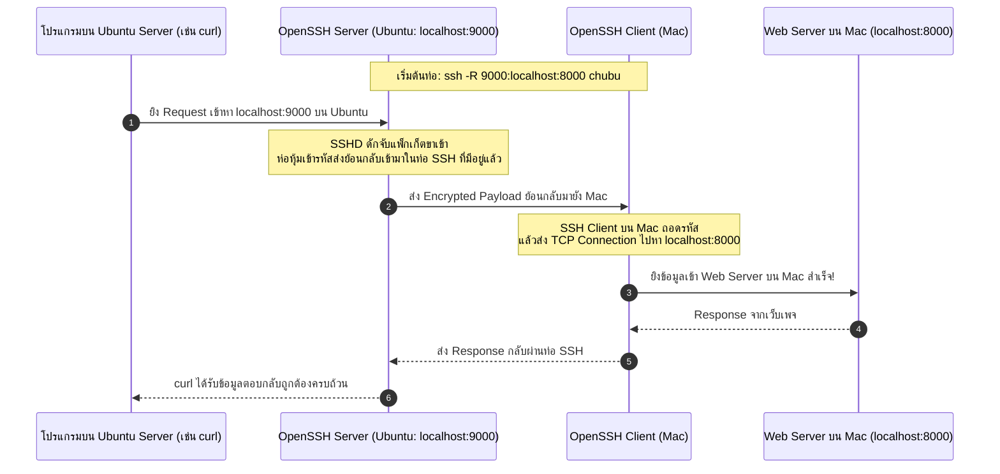

# SSH Remote Port Forwarding (-R)

**Remote Port Forwarding (`-R`)** หรือที่มักเรียกว่า **Reverse SSH Tunnel** คือกลไกที่ใช้สำหรับ **"ไปสั่งให้เครื่อง Server ปลายทางเปิดพอร์ตดักฟังไว้ แล้วส่งต่อข้อมูลย้อนกลับเข้ามาหาเซอร์วิสที่รันอยู่บนเครื่อง Client ของเรา"**

---

## 1. ไวยากรณ์และโครงสร้างคำสั่ง

```bash
ssh -R [remote_bind_address:]remote_port:destination_host:destination_port user@ssh_server
```

### คำสั่งแก้ปัญหา Localhost ในการทดลองจริง

```bash
# รันบนเครื่อง Mac เพื่อเปิดพอร์ต 9000 บน Ubuntu ให้ชี้กลับมาหา Web Server พอร์ต 8000 บน Mac
ssh -N -f -R 9000:localhost:8000 chubu
```

- **`-R` (Remote Forward):** สั่งเปิดพอร์ตดักฟังที่เครื่องแม่ข่าย (Ubuntu)
- **`9000` (Remote Port):** พอร์ตที่ต้องการให้ Ubuntu เปิดดักฟัง
- **`localhost` (Destination Host):** ปลายทางที่ต้องการส่งไปถึง (มองจากมุมของเครื่อง Mac)
- **`8000` (Destination Port):** พอร์ตของ Web Server บนเครื่อง Mac ที่กำลังรันอยู่

---

## 2. แผนภาพการไหลของแพ็กเก็ต (Reverse Packet Flow)



> [!NOTE] 🔬 ผลการทดลองจริง (Verified in Lab)
> ในการทดลองเปิด Web Server บน Mac (`python3 -m http.server 8000`) เมื่อเราใช้คำสั่ง Remote Forwarding นี้ จะทำให้โปรแกรมใด ๆ บนเครื่อง Ubuntu สามารถเรียกดูหน้าเว็บจาก Mac ได้ผ่านคำสั่ง `curl http://localhost:9000` ทันที

---

## 3. การเปิดให้ผู้อื่นเข้าถึงพอร์ต Remote (`GatewayPorts`)

ตามค่ามาตรฐาน `sshd` จะผูกพอร์ตที่เปิดด้วย `-R` ไว้กับ Loopback (`127.0.0.1`) ของเครื่อง Server เท่านั้น หากต้องการให้อุปกรณ์อื่นภายนอกยิงเข้ามาหาพอร์ตนั้นได้ จะต้องตั้งค่าบน Server ใน `/etc/ssh/sshd_config`:

```sshdconfig
GatewayPorts yes
```
และสั่งรีสตาร์ตด้วย `sudo systemctl restart ssh`

---

## 🔗 โหนดความรู้ที่เกี่ยวข้อง (Related Nodes)
- [[Localhost-Loopback-and-Port-Binding]] — ทำไม `localhost` ข้ามเครื่องถึงไม่ทำงาน
- [[SSH-Local-Port-Forwarding]] — การทำ Forwarding ในทิศทางปกติ (-L)
- [[SSH-Dynamic-Port-Forwarding-and-SOCKS5]] — ทางเลือกการเปิด Dynamic SOCKS Proxy (-D)
- [[SSH-Command-Reference-and-Cheatsheet]] — สรุปตัวเลือกคำสั่ง `-R`
