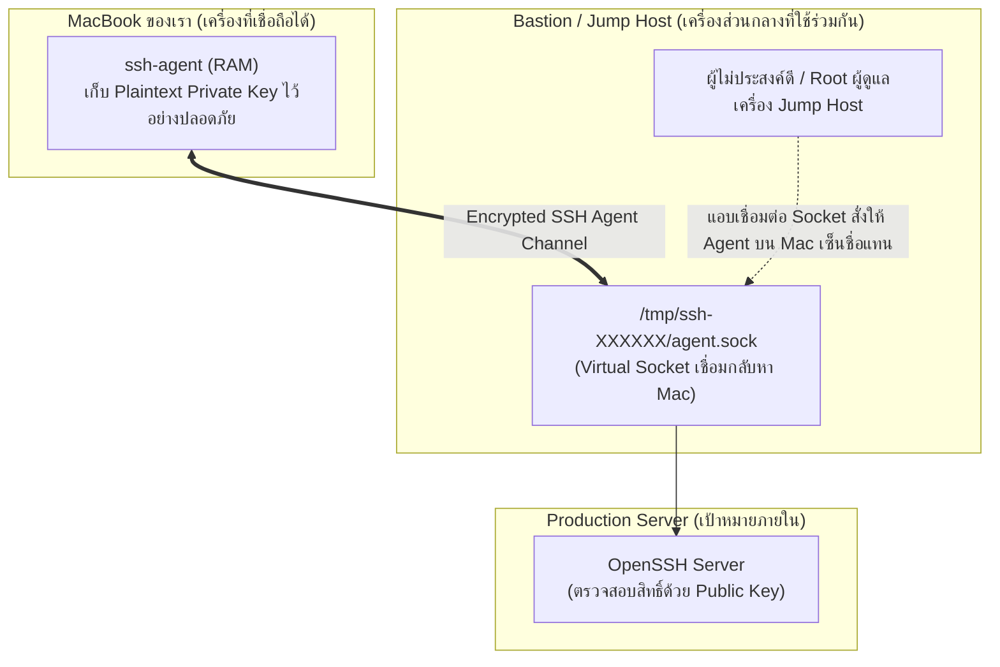

# SSH Agent Forwarding & Security Threats

**SSH Agent Forwarding (`-A` หรือ `ForwardAgent yes`)** เป็นฟีเจอร์ที่ถูกคิดค้นขึ้นเพื่อความสะดวกในการกระโดดข้ามเครื่อง (Multi-Hop / Jump Host) โดยไม่ต้องคัดลอกไฟล์ Private Key ไปวางไว้บนเครื่องแม่ข่ายคนกลาง แต่แลกมาด้วยความเสี่ยงทางความปลอดภัยระดับวิกฤตหากใช้งานผิดวิธี

---

## 1. การทำงานและจุดประสงค์ดั้งเดิม

เมื่อคุณต้องการเชื่อมต่อไปยัง **Target Server** ภายใน แต่ต้องผ่าน **Bastion / Jump Host** ก่อน:

```bash
# ส่งต่อ Agent Socket ไปยัง Jump Host
ssh -A user@jump-host
# จากนั้นบน Jump Host สามารถต่อเข้าเครื่อง Target ได้ทันที
jump-host$ ssh user@target-server
```

- **ข้อดี:** คุณไม่ต้องเอาไฟล์ `id_ed25519` ไปวางไว้บน Jump Host คีย์ยังคงนอนอยู่บน Mac ของคุณเหมือนเดิม

---

## 2. ภัยคุกคาม: Agent Socket Hijacking Attack

เมื่อเราเปิด Agent Forwarding ตัวเครื่อง Client จะสร้าง **UNIX Domain Socket เสมือน** ไปโผล่ไว้บนเครื่อง Jump Host ที่ `/tmp/ssh-XXXXXX/agent.sock`:



> [!CAUTION] 📚 กลไกการโจมตี Socket Hijacking
> หาก Jump Host นั้นถูก Compromise หรือมีผู้ใช้คนอื่นที่มีสิทธิ์ `root` หรือสามารถเข้าถึงโฟลเดอร์ `/tmp` ได้:
> 1. ผู้โจมตีไม่จำเป็นต้องขโมย Private Key ของคุณ
> 2. ผู้โจมตีสามารถกำหนดตัวแปร `SSH_AUTH_SOCK=/tmp/ssh-XXXXXX/agent.sock` ใน Terminal ของเขา
> 3. แล้วสั่งรันคำสั่ง SSH เจาะเข้าเซิร์ฟเวอร์อื่น ๆ ทั้งหมดที่คุณมีสิทธิ์ ตัว Agent บนเครื่อง Mac ของคุณจะประทับตราอนุมัติให้โดยอัตโนมัติ!

---

## 3. ทางเลือกที่ปลอดภัยกว่าในปัจจุบัน: `ProxyJump` (`-J`)

เพื่อกำจัดความเสี่ยงจากการแชร์ Agent Socket บนเครื่องสาธารณะ OpenSSH 7.3+ ได้นำเสนอคำสั่ง **`ProxyJump` (แฟลก `-J`)**:

```bash
ssh -J user@jump-host user@target-server
```

หรือกำหนดใน `~/.ssh/config`:

```sshconfig
Host target-server
    HostName 10.0.1.50
    User chubu
    ProxyJump user@jump-host
    IdentityFile ~/.ssh/id_ed25519
```

- **ทำไม `ProxyJump` จึงปลอดภัยกว่า?**
  - `ProxyJump` ทำหน้าที่เพียงแค่ส่งต่อ Raw TCP Stream จาก Mac ไปยัง Target Server โดยตรง (TCP Forwarding)
  - **ไม่มีการเปิดหรือส่งต่อ Agent Socket ไปยัง Jump Host แม้แต่บิตเดียว**
  - กระบวนการ Authentication เกิดขึ้นระหว่าง Mac กับ Target Server โดยตรง Jump Host เป็นเพียงทางผ่านของท่อเครือข่ายเท่านั้น

---

## 🔗 โหนดความรู้ที่เกี่ยวข้อง (Related Nodes)
- [[SSH-Agent-and-Memory-Security]] — พื้นฐานการทำงานของ `ssh-agent`
- [[SSH-Client-Configuration-and-Aliases]] — การตั้งค่า `ProxyJump` ในคอนฟิก
- [[SSH-Command-Reference-and-Cheatsheet]] — สรุปตัวเลือกคำสั่ง `-A` เทียบกับ `-J`
