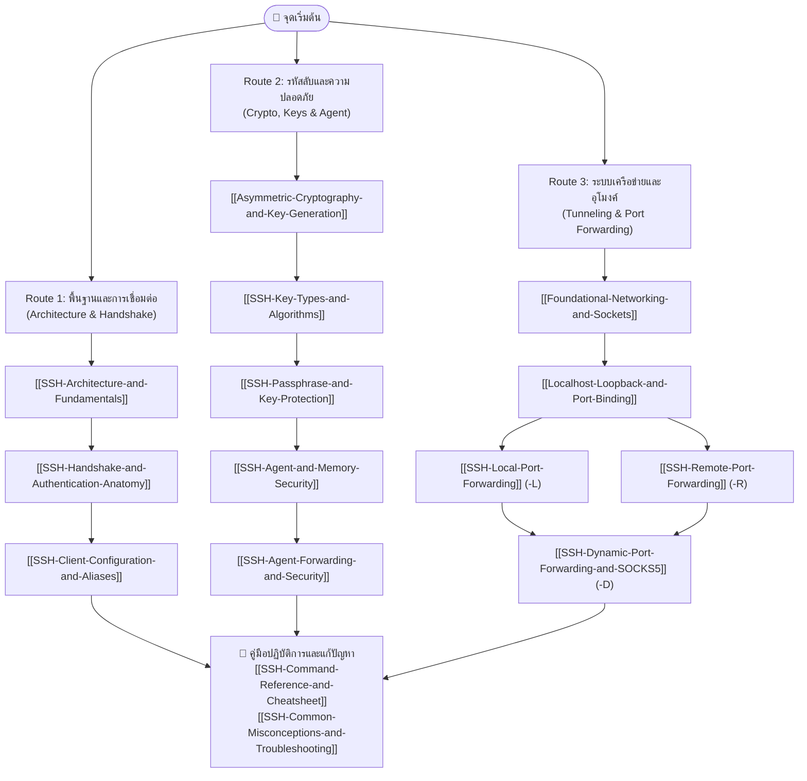
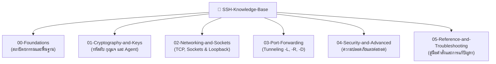

	
# SSH Personal Technical Knowledge Base

> [!important] จุดเริ่มต้นใหม่
> ใช้งาน SSH ระหว่างวันให้เปิด [[SSH-Daily-Playbook]] ก่อน ส่วนหน้านี้เป็นแผนที่ความรู้และบทเรียนเชิงลึก
>
> กลับไปยังแผนที่รวมของ Vault: [[START-HERE]]

ยินดีต้อนรับสู่ **SSH Knowledge Base** — คลังความรู้เชิงวิศวกรรมระบบและวิทยาการรหัสลับเกี่ยวกับ **Secure Shell (SSH)** ออกแบบมาเพื่อเน้นความเข้าใจเชิงลึกในระดับ **"กลไกการทำงานจริง (Under the Hood)"**, การแกะรอย Network Packet/Sockets, การทำความเข้าใจ One-Way Trapdoor Function, ตลอดจนบทเรียนจริงจากการทำ Lab เชื่อมต่อระหว่าง macOS และ Ubuntu Server

เอกสารทั้งหมดถูกจัดโครงสร้างเป็น **Atomic Notes** ที่เชื่อมโยงถึงกันอย่างสมบูรณ์ รองรับการนำทางผ่าน Obsidian Graph View และ Interactive WikiLinks

---

## 🗺️ แผนผังเส้นทางการเรียนรู้ (Learning Pathways & Routes)

เริ่มจาก [[SSH-Daily-Playbook]] หากต้องการเชื่อมต่อ Server, ใช้ Key หรือเปิด Tunnel ทันที

เพื่อให้การศึกษาเนื้อหามีลำดับขั้นตอนที่เข้าใจง่าย สามารถเลือกเดินตามเส้นทาง (Routes) ตามความต้องการได้ดังนี้:

---

## 📂 โครงสร้างโฟลเดอร์และสารบัญเนื้อหา (Knowledge Base Directory)

---

### `00-Foundations/` — สถาปัตยกรรมและโปรโตคอลพื้นฐาน
*ปูพื้นฐานกระบวนการทำงาน การแบ่ง Layer และการตรวจจับเหตุการณ์ระหว่างเชื่อมต่อ*
- **[[SSH-Architecture-and-Fundamentals]]** — เจาะลึกความต่างของ Client (`ssh`) vs Daemon (`sshd`), สถาปัตยกรรม 3 เลเยอร์ของ RFC 4251 และสรุปสภาพแวดล้อม Lab
- **[[SSH-Handshake-and-Authentication-Anatomy]]** — ลำดับขั้น Handshake 5 เฟส, ถอดรหัส Verbose Log (`Offering public key` vs `Server accepts key`), และความต่างของ Host Auth (`known_hosts`) vs User Auth (`authorized_keys`)
- **[[SSH-Client-Configuration-and-Aliases]]** — จัดการคอนฟิก `~/.ssh/config`, การตั้งค่า Host Alias, เหตุผลที่ต้องใส่ `IdentitiesOnly yes`, และการรักษาการเชื่อมต่อด้วย `ServerAliveInterval`

---

### `01-Cryptography-and-Keys/` — วิทยาการรหัสลับและกุญแจ
*ความเข้าใจเรื่องคณิตศาสตร์กุญแจ ทำไมย้อนกลับไม่ได้ และการปกป้องกุญแจในดิสก์และหน่วยความจำ*
- **[[Asymmetric-Cryptography-and-Key-Generation]]** — ฟังก์ชันทางเดียว (Trapdoor Function: $Q = d \times G$), ปัญหา Discrete Logarithm, และกลไก Digital Signature ที่ทำให้ **Private Key ไม่ต้องส่งผ่าน Network**
- **[[SSH-Key-Types-and-Algorithms]]** — เปรียบเทียบ ED25519 vs RSA vs ECDSA vs DSA, ทำไม ED25519 ถึงเป็นมาตรฐานแนะนำสูงสุด, และ Hardware Keys (`ed25519-sk`)
- **[[SSH-Passphrase-and-Key-Protection]]** — สถาปัตยกรรม Local Symmetric Encryption บนดิสก์, Passphrase ต่างจาก Linux Password อย่างไร, และการเปลี่ยนรหัสผ่านด้วย `ssh-keygen -p`
- **[[SSH-Agent-and-Memory-Security]]** — สถาปัตยกรรม Signature Oracle ของ `ssh-agent`, คำสั่ง `ssh-add` (-l, -L, -D), และการทำงานร่วมกับ Apple Keychain บน macOS

---

### `02-Networking-and-Sockets/` — ระบบเครือข่ายและ Sockets พื้นฐาน
*ถอดรหัสการเคลื่อนที่ของข้อมูล TCP, ข้อจำกัดของ Private IP และการผูก Port*
- **[[Foundational-Networking-and-Sockets]]** — พื้นฐาน TCP 3-Way Handshake, Socket 4-Tuple, ข้อจำกัดของ RFC 1918 Private IP, และ Network Namespaces
- **[[Localhost-Loopback-and-Port-Binding]]** — ปริศนา *"ทำไม localhost:8000 บน Ubuntu มองไม่เห็น Mac"*, Loopback Isolation, และความต่างของการ Bind ระหว่าง `127.0.0.1` vs `0.0.0.0`

---

### `03-Port-Forwarding/` — การสร้างอุโมงค์ข้อมูล (Tunneling)
*การทำ Port Forwarding ทะลวงไฟร์วอลล์ทั้ง 3 โหมด*
- **[[SSH-Local-Port-Forwarding]]** — กลไก `-L` (เปิดประตูที่ Client ส่งออกที่ Server) พร้อม Packet Flow Diagram สำหรับทะลวงไฟร์วอลล์เข้าหา Database ภายใน
- **[[SSH-Remote-Port-Forwarding]]** — กลไก `-R` (เปิดประตูที่ Server ส่งย้อนกลับมาหา Client) ตัวช่วยสำคัญในการแก้ปัญหาการทดสอบ Localhost ข้ามเครื่อง
- **[[SSH-Dynamic-Port-Forwarding-and-SOCKS5]]** — การเปิด SOCKS5 Proxy ด้วย `-D`, ความต่างจาก HTTP Proxy, และการทำ Remote DNS Lookup ด้วย `--socks5-hostname` ป้องกัน DNS Leak

### `03-File-Transfer/` — การส่งและดึงไฟล์
*เลือกเครื่องมือให้เหมาะกับการคัดลอกไฟล์ครั้งเดียวหรือการจัดการหลายไฟล์*
- **[[SSH-SCP-File-Transfer]]** — ส่งและดึงไฟล์ด้วย `scp`, รวมการคัดลอกโฟลเดอร์ด้วย `-r`, Port `-P` และการตรวจสอบ Hash
- **[[SSH-SFTP-File-Transfer]]** — เปิด Session เพื่อ browse, `get`, `put`, จัดการโฟลเดอร์ และทำงานแบบ Batch

---

### `04-Security-and-Advanced/` — ความปลอดภัยขั้นสูงและประเด็นต่อยอด
*ภัยคุกคามที่ต้องระวัง และหัวข้อวิจัยระดับ Enterprise*
- **[[SSH-Agent-Forwarding-and-Security]]** — ข้อดีและภัยคุกคามระดับวิกฤตของ `ssh -A`, การจำลองการโจมตี Socket Hijacking บน Bastion Host, และทำไม `ProxyJump` (`-J`) ถึงปลอดภัยกว่า
- **[[SSH-Knowledge-Gaps-and-Future-Labs]]** — บันทึกประเด็นที่ยังไม่ได้ทดลองจริงในแล็บนี้ (เช่น YubiKey FIDO2, SSH Certificate Authority) สำหรับศึกษาต่อ

---

### `05-Reference-and-Troubleshooting/` — คู่มือคำสั่งและการแก้ปัญหา
*สรุปคำสั่งที่ใช้บ่อย และคู่มือวิเคราะห์ Error*
- **[[SSH-Command-Reference-and-Cheatsheet]]** — สรุปคำสั่งครบวงจร (`ssh`, `ssh-keygen`, `ssh-add`, `ssh-copy-id`, `scp`, `sftp`) พร้อมตารางวิเคราะห์ความหมายของ Arguments
- **[[SSH-Common-Misconceptions-and-Troubleshooting]]** — ตารางสรุป 5 ความเข้าใจผิดยอดฮิต และวิธีแก้ปัญหา Error ยอดนิยม (`Permission denied`, `Too many authentication failures`)

---

## 🔬 สภาพแวดล้อมระบบทดสอบในแล็บ (Verified Lab Environment)

การทดลองทั้งหมดในคลังความรู้นี้ได้รับการทดสอบและยืนยันผลจริงบนสภาพแวดล้อม:
- **SSH Client:** MacBook Air (Apple Silicon, macOS Sonoma)
- **SSH Server:** Ubuntu Server 22.04 LTS (Hostname: `chubu-server`, User: `chubu`)
- **Server IP:** `192.168.64.8` (TCP Port 22)
- **Client Host Alias:** `Host chubu` (ใน `~/.ssh/config`)

---

## 💡 คำแนะนำในการใช้งานร่วมกับ Obsidian
- กด **`Cmd + G`** (หรือคลิกที่ไอคอน Graph View) เพื่อดูโครงข่ายความรู้ทั้งหมดกางออกเป็นคลัสเตอร์ที่เชื่อมโยงกัน
- เมื่อเปิดเอกสารใดก็ตาม สามารถเปิดแผง **Linked Mentions** หรือ **Local Graph** ด้านขวา เพื่อดูว่าหัวข้อดังกล่าวมีจุดเชื่อมโยงกับหัวข้อใดบ้าง
