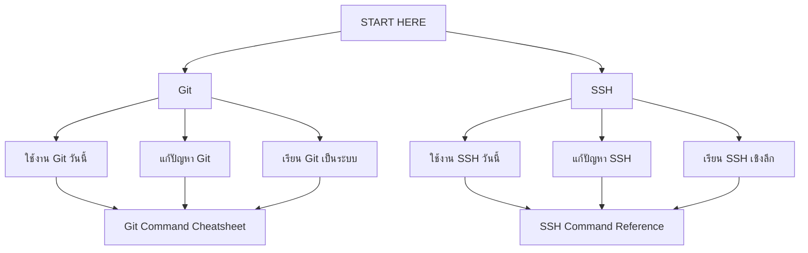

# Knowledge Base: เริ่มตรงนี้

หน้านี้คือจุดเริ่มต้นเดียวของ Knowledge Base ทั้งหมด  
เลือกตามสิ่งที่กำลังจะทำ ไม่ต้องอ่านทุกไฟล์ตามลำดับโฟลเดอร์

## เลือกเส้นทาง

## Git

| เป้าหมาย | เปิดหน้านี้ |
|---|---|
| ทำงานประจำวัน ตั้งแต่เริ่มงานจนส่ง PR | [[Git-Daily-Playbook]] |
| ค้นคำสั่งอย่างรวดเร็ว | [[Git-Command-Cheatsheet]] |
| แก้ปัญหาหรือกู้คืนงาน | [[Troubleshooting-Scenarios]] |
| เรียนจากพื้นฐานไปขั้นสูง | [[Git-Learning-Roadmap]] |
| เข้าใจกลไกภายใน | [[Git-Architecture]] |

## SSH

| เป้าหมาย | เปิดหน้านี้ |
|---|---|
| เชื่อมต่อ Server, ส่งไฟล์ และใช้งาน Tunnel | [[SSH-Daily-Playbook]] |
| ค้นคำสั่ง SSH | [[SSH-Command-Reference-and-Cheatsheet]] |
| แก้ปัญหา Login, Key และ Tunnel | [[SSH-Common-Misconceptions-and-Troubleshooting]] |
| เรียน SSH ตั้งแต่พื้นฐาน | [[SSH-Knowledge-Base/README|SSH Knowledge Base Home]] |
| เข้าใจ Handshake และ Authentication | [[SSH-Handshake-and-Authentication-Anatomy]] |

## วิธีอ่าน

1. ใช้ **Daily Playbook** เมื่อกำลังทำงานจริง
2. ใช้ **Troubleshooting** เมื่อมี Error
3. เปิด **Deep Dive** เมื่ออยากเข้าใจเหตุผลเบื้องหลัง
4. ใช้ **Reference** เมื่อต้องการค้นคำสั่ง ไม่ต้องอ่านตั้งแต่ต้น

> [!tip] Graph View
> ให้เปิด Local Graph ของหน้านี้ แล้วขยายไปยัง Git หรือ SSH จะเห็นเส้นทางหลักโดยไม่ถูกรบกวนด้วยรายละเอียดทุกโน้ตในคลัง
