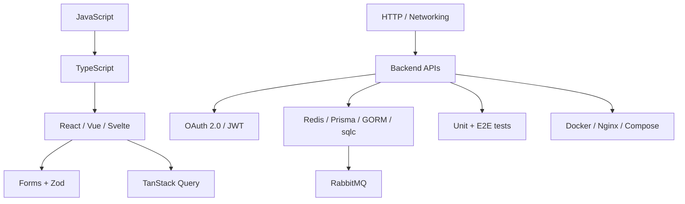

# Knowledge Map

## พื้นฐานร่วม

## ทางเดินแนะนำ

- **Frontend:** [[JavaScript]] → [[TypeScript]] → framework overview → forms/state/data → [[Vitest]] → [[Playwright]]
- **Backend Go:** [[Go]] → [[Gin]] หรือ [[Fiber]] → [[Go-Testing]] → [[GORM]] หรือ [[sqlc]] → [[Docker]]
- **Backend TypeScript:** [[JavaScript]] → [[TypeScript]] → runtime/framework → [[Zod]] → [[Vitest]] → [[Docker]]
- **Backend Python:** [[FastAPI]] → HTTP/OpenAPI → testing → [[Docker]] / [[Nginx]]
- **Auth:** [[HTTP]] → [[OAuth-2.0]]; อ่าน [[JWT]] เมื่อระบบเลือกใช้ JWT token
- **Infrastructure:** [[Docker]] → [[Docker-Compose]] → [[Nginx]]; เพิ่ม [[RabbitMQ]] เมื่อมี async messaging use case

## หลักแยกหน้าที่

- Server state ไม่ใช่ UI state: เริ่มจาก [[TanStack-Query]] สำหรับ remote data และ store เฉพาะ state ที่แอปเป็นเจ้าของ
- Authentication, authorization, token format เป็นคนละแนวคิด: OAuth 2.0 เป็น authorization framework; JWT เป็นรูปแบบ token
- ORM และ SQL-first ต่างมี trade-off: [[Prisma]] / [[GORM]] เทียบกับ [[sqlc]] ตามความต้องการควบคุม SQL, migration และ type safety
